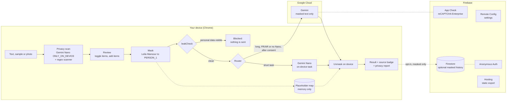

# SafeShare

**Use powerful cloud AI on private documents, without sending your private data to the cloud.**

Gemini Nano, running inside Chrome, finds and hides personal data on your device. Cloud Gemini only ever sees placeholders such as `[PERSON_1]`, and the real values are put back on your screen afterwards.

[](LICENSE)


- **Live app:** https://safeshare-ee7d7.web.app
- **Demo video:** [Watch the 3-minute demo](https://youtu.be/TODO) <!-- TODO: replace with the YouTube link -->
- Built for the **#BuildHybridAI 2026** hackathon (Web / Chrome category).

## Screenshots

> Placeholders: see [docs/screenshots/README.md](docs/screenshots/README.md) for what each image shows.

| Landing | Review | Consent | Result |
|---|---|---|---|
|  |  |  |  |

## What it does

1. **Input:** paste text, load a sample, or drop a photo of a document (read on-device).
2. **Scan on your device:** Gemini Nano returns structured JSON of personal items; a regex scanner runs too.
3. **Review:** colour-coded highlights, switches per item and per type (with Undo), and a *Masked preview* that shows exactly what the cloud would see.
4. **Task:** summarise, rewrite (formal or simple), translate (English, French, Arabic) or ask a question.
5. **Route:** short tasks run on-device; long documents, French/Arabic translations, or devices without Gemini Nano use cloud Gemini, after a consent dialog and with masked text only.
6. **Result:** the answer with real values restored locally, a badge showing where it ran and why, and a privacy report.

## How SafeShare uses Firebase AI Logic hybrid inference

All inference goes through [Firebase AI Logic](https://firebase.google.com/docs/ai-logic/hybrid/web/get-started) (`firebase/ai`). Every model is created once in [src/lib/ai/models.ts](src/lib/ai/models.ts).

| Feature | Inference mode | Why | Source |
|---|---|---|---|
| Privacy scan (find personal data) | `ONLY_ON_DEVICE` + structured output (`responseConstraint` schema) | The raw document must never leave the device. | [`scanModel()`](src/lib/ai/models.ts), [scan.ts](src/lib/pii/scan.ts) |
| Reading a photo of a document | `ONLY_ON_DEVICE`, multimodal (image input declared in `expectedInputs`) | The photo must never be uploaded. | [`imageReadModel()`](src/lib/ai/models.ts), [read.ts](src/lib/image/read.ts) |
| Short tasks before cloud consent | `ONLY_ON_DEVICE` | Fast and private; cannot silently fall back to the cloud without consent. | [`deviceTaskModel()`](src/lib/ai/models.ts), [run.ts](src/lib/tasks/run.ts) |
| Short tasks after cloud consent | `PREFER_ON_DEVICE` | On-device first, with a masked-text cloud fallback the user has agreed to. | [`hybridModel()`](src/lib/ai/models.ts) |
| Long documents, French/Arabic translation, no Gemini Nano | `ONLY_IN_CLOUD` | Beyond the on-device model's limits; only masked text is sent. | [`cloudModel()`](src/lib/ai/models.ts), [router.ts](src/lib/tasks/router.ts) |
| Where did it run? | `response.inferenceSource` | Every result shows an On-device (green) or Cloud (blue) badge with the routing reason. | [source.ts](src/lib/ai/source.ts), [SourceBadge.tsx](src/components/SourceBadge.tsx) |
| Model download | `initializeDeviceModel()` from a click, with progress | The one-time Gemini Nano download is explicit and visible. | [device.ts](src/lib/ai/device.ts) |
| Device status card | Chrome `LanguageModel.availability()` (**UI status only**) | Shows "ready / download / not available"; never used for inference. | [device.ts](src/lib/ai/device.ts) |

**Routing rules**, in order ([router.ts](src/lib/tasks/router.ts), all unit-tested):
1. The privacy scan and image reading are always on-device. Without Gemini Nano, a regex-only scan is used and image input is disabled.
2. Translation into French or Arabic goes to the cloud.
3. Masked text longer than `device_max_chars` (Remote Config, default 3,000) goes to the cloud.
4. If the device model is not `"available"`, the task goes to the cloud.
5. Otherwise the task runs on the device.

## Architecture



## Privacy design

| Promise | How it is enforced |
|---|---|
| Your original text and images never leave this device. | The scan and image reading are `ONLY_ON_DEVICE`. Tasks receive only masked text. A unit test checks that every on-device model has no cloud parameters. |
| Cloud AI only sees placeholders such as `[PERSON_1]`. | [`leakCheck()`](src/lib/pii/mask.ts) runs on the full prompt before every task call and blocks it with a `LeakError` (no model is called). It catches any letter case and parts of names ("Mr Moreau"). The *Ask* question is scanned on-device too. |
| Real values are restored on your device and are never saved. | The placeholder map exists only inside one function call. It is never put in React state, storage, logs or requests. |
| You decide before anything goes to the cloud. | A consent dialog shows the exact masked prompt and its character count before the first cloud call of a session. On-device tasks cannot fall back to the cloud before consent. |
| History is optional and masked. | History is off by default. When on, the record masks **every** detected item (even ones shown to the AI), passes a strict `leakCheck`, and is stored under `users/{uid}/history`, readable only by the owner ([firestore.rules](firestore.rules)). |

What is masked by default: names, emails, phone numbers, ID numbers, addresses, IBAN and card numbers, health details, dates of birth, other dates, and company names. Role words (Client, Consultant…), plain years and clause numbers stay readable so the AI can follow the document. The full table is in [docs/SPEC.md §7](docs/SPEC.md).

**Other safeguards:**
- There is no `console` logging in the code (enforced by ESLint).
- The App Check debug token exists only in development on `localhost` and is stripped from production builds (tested).
- Only invented sample data is used.

**Known limits:**
- Without Gemini Nano, the regex scanner cannot detect names or addresses. You can add them in Review by selecting the text.
- The model may reword values in its answer. History refuses to store anything date-like or known that survives.
- The Firestore rules check ownership but not the size of fields.

## Run it locally (Ubuntu)

**1. Prerequisites:** Node.js 20 or newer (tested with Node 26 via [nvm](https://github.com/nvm-sh/nvm)), Git, and desktop Google Chrome 139 or newer.

```bash
curl -o- https://raw.githubusercontent.com/nvm-sh/nvm/v0.40.3/install.sh | bash
nvm install --lts
git clone https://github.com/SalemBenafia/safeshare.git
cd safeshare
npm ci
cp .env.example .env.local   # then fill in the values
```

**2. Firebase project.** Fill in `.env.local` from Firebase console → Project settings → Your apps → Web app. Then:
- **AI Logic:** get started with the **Gemini Developer API**.
- **App Check:** register the web app with **reCAPTCHA Enterprise**, and put the site key in `NEXT_PUBLIC_RECAPTCHA_ENTERPRISE_SITE_KEY`. In development the SDK prints a debug token in the browser console; add it under App Check → Manage debug tokens.
- **Authentication:** enable **Anonymous** (used only for the optional history).
- **Firestore:** create a database, then run `firebase deploy --only firestore` to deploy the rules.
- **Remote Config (optional):** add `cloud_model`, `device_max_chars`, `scan_chunk_chars` and `history_enabled`. The app has in-app defaults.

**3. Gemini Nano in Chrome.**
- Open `chrome://flags/#prompt-api-for-gemini-nano-multimodal-input`, set it to **Enabled**, and relaunch Chrome.
- Hardware: at least 22 GB of free disk; a GPU with more than 4 GB of VRAM, or 16 GB of RAM and 4+ CPU cores.
- Check the model at `chrome://on-device-internals`, or click **Download the private AI model** on the SafeShare home page.

**4. Start.**
```bash
npm run dev            # http://localhost:3000
```

To check the production build locally:
```bash
npm run build && firebase emulators:start --only hosting   # http://localhost:5000
```

## Testing (for judges)

**Automated:**
```bash
npm run lint    # ESLint, including a no-console rule
npm run test    # Vitest: scan, masking, leak check, router, prompts, history, settings…
npm run build   # static export to out/
```

**With Gemini Nano** (Chrome with the flag):
1. On the home page, the card says **Private AI is ready on this device**.
2. **Try a sample** opens the workspace with an invented CV. Click **Scan for personal data**: "Scanned on-device. Nothing left your computer." In DevTools → Network → *Offline*, scanning still works.
3. In Review, open **Masked preview** to see exactly what a cloud model would receive.
4. Choose **Summarise**, then **Run on this device**. The answer streams in with a green **On-device** badge.
5. Load **Long contract** and summarise it. The consent dialog shows the masked prompt; choose **Send masked text to cloud**.
   - In DevTools → Network, the request payload contains only placeholders.
   - The result shows a blue **Cloud** badge, the real names restored, and the Privacy report.
6. **Ask a question** that contains a new e-mail address: the task is blocked, and nothing is sent.

**Without Gemini Nano** (Firefox, or Chrome without the flag):
- An amber card explains that on-device AI is not available, with a link to the setup guide.
- Scanning uses the **basic scanner**. Emails, phones, IBAN, cards and dates are found; add names in Review by selecting them.
- Every task is routed to the cloud: the consent dialog appears first, and only masked text is sent.
- Photo input is disabled, with the message "Reading images needs on-device AI, so your document photo never leaves your computer."

The `/about` page has a **Diagnostics** panel showing the active settings and their source, the device status, and where the last answer ran.

## Tech stack

- **Next.js 16** (App Router, static export) with React 19, TypeScript (strict) and Tailwind CSS 4.
- **Firebase JS SDK 13:**
  - **AI Logic** (hybrid on-device/cloud inference, Gemini Nano + Gemini);
  - **App Check** (reCAPTCHA Enterprise);
  - **Anonymous Auth** and **Cloud Firestore** (optional masked history);
  - **Remote Config** (settings);
  - **Hosting**.
- **Vitest** for unit tests and **ESLint** for linting.

```
src/
  app/            routes: /, /workspace, /history, /about, /playground (dev only)
  components/     UI (workspace steps, consent dialog, badges, history)
  hooks/          useDeviceStatus, useSettings
  lib/
    ai/           models (inference modes), device status, inference source
    pii/          scan, regex, dates, clean-up, mask/unmask/leakCheck
    tasks/        prompts, router, runTask, errors, question check
    workspace/    reducer (pure, tested)
docs/SPEC.md      product and technical spec
```

## License

[Apache-2.0](LICENSE)
